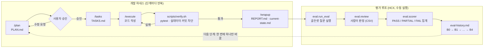
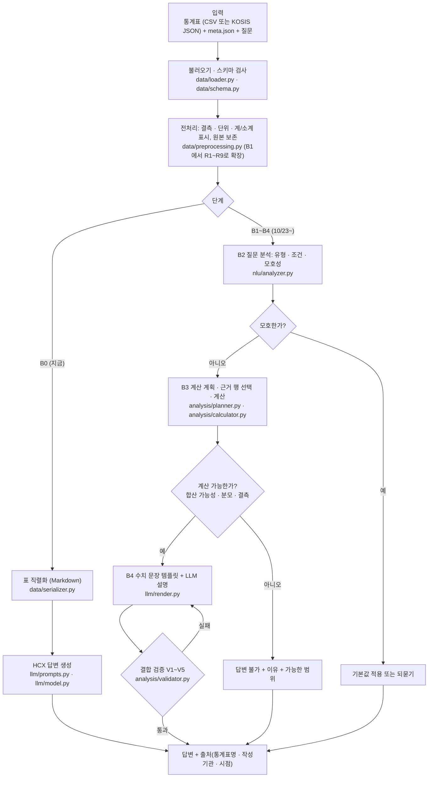
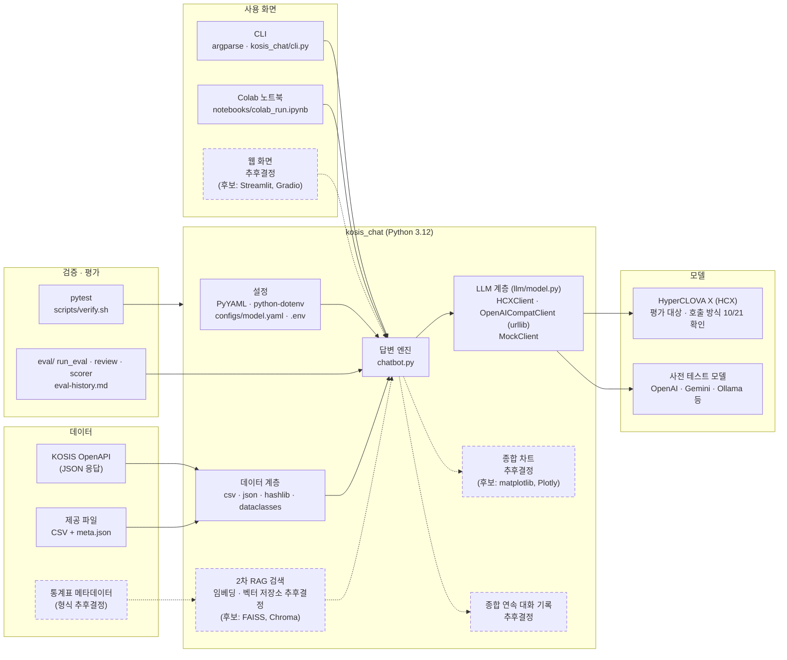

# KOSIS 챗봇 진행 지도

2026-10-21 기준. 실선 = 확정, 점선(`tbd`) = 추후결정.
같은 내용의 웹 페이지: https://claude.ai/artifact/LfUNCe2PzTd7aWdKYzmg64

## 1. 전체 일정

실전 1에서 만든 챗봇을 실전 2와 종합에서 키워 간다. 1차는 B0(베이스라인) 점수를 먼저 내고, 한 번에 하나씩 바꾸며 B1~B4로 올린다.

### 실전 1 · 통계 수치 요약 (~10/28)

표 데이터 + 자연어 질문 → 자연어 답변

| 날짜 | 할 일 | 상태 |
| --- | --- | --- |
| 10/20 | 설계, B0 코드(오프라인) | 완료 |
| 10/21 | HCX 호출 방식, B0용 표 1개 확인 | 오늘 |
| 10/22 | 골든셋 v1 → B0 실행·채점 | |
| 10/23 | B1 전처리 · B3 계산 · B4 검증 모듈 (LLM 없이 테스트) | |
| 10/24 | **E2E 게이트**: 실제 표 1개 전체 흐름 | |
| 10/25–26 | 표 4~9개로 확대, 전체 평가, 개선 1회 | |
| 10/27 | 게이트 통과 시 직렬화 3종 비교 | |
| 10/28 | 문서 정리, 제출 | |

### 실전 2 · 통계표 안내 (~11/04)

RAG로 메타데이터를 검색해 맞는 통계표를 찾아 준다.

- 확정: RAG 방식, 1차 챗봇 재사용
- 추후결정: 메타데이터 형식, 임베딩 모델, 벡터 저장소, 세부 일정

### 종합 · 통합 챗봇 (~12/07)

표 탐색 + 수치 분석 + 차트 + 연속 대화

- 확정: 1차·2차 기능을 합친 하나의 서비스
- 추후결정: 차트 도구, 화면(UI), 대화 기록 방식, 배포

## 2. 작업 방식 (하네스 + 평가 루프)

모든 단계는 같은 순서로 진행한다. 계획 승인 후 코딩, 오프라인 검증(verify.sh)과 HCX 평가는 따로 확인한다. 평가 결과는 같은 골든셋·데이터·모델로 eval-history.md에 한 줄씩 쌓는다.

- 비교 규약: 데이터 해시, 골든셋 버전, 모델, temperature 0, runs 1 고정. 실행마다 manifest.json.
- 사전 테스트: `openai_compat` 백엔드로 다른 모델 연결 가능. 결과는 `pretest`로 표시되고 점수표에 들어가지 않는다.
- 규칙: API 키는 .env에만. 실데이터·골든셋·평가 결과는 커밋 금지. 표에서 추적할 수 없는 수치, 인과·정치적 주장 금지.

## 3. 실전 1 답변 흐름 (B0 → B4)

B0는 표를 그대로 프롬프트에 넣고 HCX가 답한다. B1~B4는 수치를 코드가 계산하고 LLM은 설명만 맡도록 단계적으로 바꾼다. 박스 안 이름은 실제 파일(B1~B4는 예정 파일).

## 4. 서비스 구성도 (라이브러리 포함)

실선 박스는 지금 코드에 들어간 라이브러리. 점선 박스는 추후결정이며, 적힌 이름은 검토 후보일 뿐이다.

| 영역 | 지금 쓰는 것 | 추후결정 |
| --- | --- | --- |
| 언어 · 실행 환경 | Python 3.12, Google Colab(VS Code 연결), Google Drive 레포 | 배포 환경 |
| 설정 · 비밀값 | PyYAML, python-dotenv | HCX 환경변수 이름 (10/21) |
| 데이터 처리 | 표준 라이브러리 csv, json, hashlib, dataclasses | pandas 도입 여부 |
| LLM 호출 | urllib (OpenAI 호환), HCX 호출부는 비어 있음 | HCX SDK 또는 REST, 모델 버전, JSON 출력 지원 |
| 테스트 · 평가 | pytest, 자체 eval/ 도구 | 합격 기준 수치 팀 합의 |
| 검색 (2차) | 없음 | 임베딩 모델, 벡터 저장소, 메타데이터 형식 |
| 차트 · 화면 (종합) | CLI, 노트북 | 차트 라이브러리, 웹 프레임워크, 대화 기록 |

## 5. 지금 기다리는 것

- 10/21: HCX 호출 방식과 모델 이름 / B0용 실제 표 1개 (분류 2단 이하, 연 단위, 계 포함) / HCX 튜닝 기능 포함 여부
- 10/22: 골든셋 v1 (약 17문항) → B0 실행 → 사람 판정 → 첫 점수
- 1차 열린 질문: 데이터를 API로 받는지 파일로 받는지 / 제출 형태 (CLI·노트북·웹) / 팀 내 담당 모듈 범위
